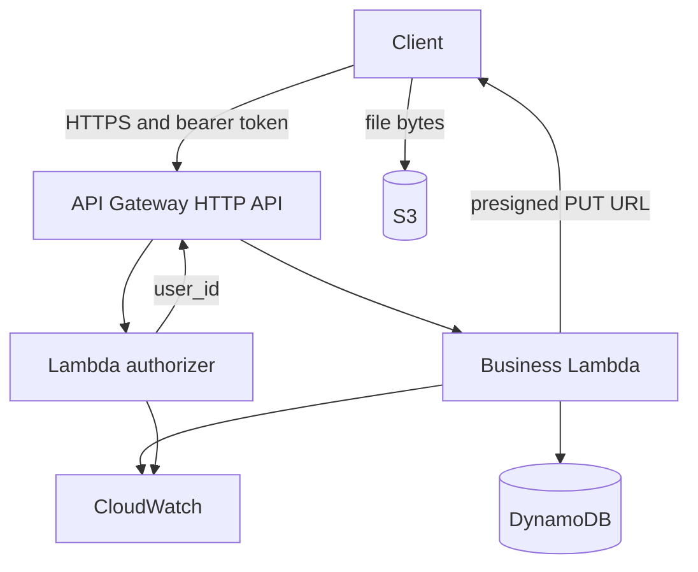

# Expense Tracker API

A Go expense API. Locally it runs in Docker against DynamoDB Local. In AWS it is meant to run as two Lambdas behind an API Gateway HTTP API, with DynamoDB, S3, and CloudWatch provisioned by Terraform.

You register, log an expense, and read a month as rows and category totals. Every expense belongs to the signed-in user.

**Local path is complete and verified.** Terraform for `dev` is written and initialized; the first `apply` is the next milestone.

## Status

| Step | What | State |
|---|---|---|
| 1 | Go handlers, JWT auth, in-memory stores, unit and handler tests | Done |
| 2 | Docker Compose + DynamoDB Local | Done |
| 3 | DynamoDB store, startup table creation, integration tests | Done |
| 4 | Business Lambda entrypoint (`APP_MODE=lambda` via `algnhsa`) | Done |
| 5 | Authorizer Lambda (`cmd/authorizer`) | Done |
| 6–9 | Terraform modules (`database`, `storage`, `monitoring`, `api`) + `environments/dev` | Written — not applied yet |
| 10–11 | Staging/prod apply, GitHub Actions + OIDC | Planned |
| 12 | Cognito JWT authorizer (phase 2) | Planned |
| 13 | Architecture diagram asset | Planned |

`POST /receipts/upload` still returns `501` until the S3 presigned PUT handler is wired.

## Prerequisites

| Tool | Notes |
|---|---|
| Go 1.26+ | Backend language |
| Docker Desktop | Local API + DynamoDB Local |
| AWS CLI v2 | `aws login` or IAM access keys |
| Terraform ≥ 1.5 | Infrastructure |

## Project initialization

### 1. Clone and enter the repo

```powershell
cd D:\DevProjects\PersonalProjects\aws-expense-tracker
```

### 2. Install Go dependencies

```powershell
cd backend
go mod tidy
go test ./...
```

### 3. Run locally with Docker (primary path)

From the **repo root**:

```powershell
cd D:\DevProjects\PersonalProjects\aws-expense-tracker
docker compose up --build
```

This starts:

| Service | Port |
|---|---|
| API (`APP_MODE=http`) | `8080` |
| DynamoDB Local | `8000` |

On startup the API creates the `users` and `expenses` tables when `DYNAMODB_ENDPOINT` is set.

Optional LocalStack (S3 only, for later receipt work):

```powershell
docker compose --profile aws up --build
```

### 4. Smoke-test the local API

```powershell
curl.exe -X POST http://localhost:8080/users/register `
  -H "Content-Type: application/json" `
  -d "{\"email\":\"me@test.com\",\"name\":\"Me\",\"password\":\"password123\"}"

curl.exe -X POST http://localhost:8080/users/login `
  -H "Content-Type: application/json" `
  -d "{\"email\":\"me@test.com\",\"password\":\"password123\"}"
```

Copy the `token`, then:

```powershell
curl.exe -X POST http://localhost:8080/expenses `
  -H "Authorization: Bearer <token>" `
  -H "Content-Type: application/json" `
  -d "{\"amount\":\"42.50\",\"category\":\"groceries\",\"date\":\"2026-10-10\"}"

curl.exe "http://localhost:8080/expenses/monthly?month=2026-10" -H "Authorization: Bearer <token>"
curl.exe "http://localhost:8080/analytics?month=2026-10" -H "Authorization: Bearer <token>"
```

Data survives `docker compose restart api`. `docker compose down` wipes DynamoDB Local (`-inMemory`).

## API

Register and login are public. Every other route needs `Authorization: Bearer <token>`. Errors: `{"error":"message"}`.

| Route | Auth | Purpose |
|---|---|---|
| `POST /users/register` | public | Create an account |
| `POST /users/login` | public | Get a JWT |
| `POST /expenses` | token | Record an expense |
| `GET /expenses/monthly?month=YYYY-MM` | token | Month rows, ordered by date |
| `GET /analytics?month=YYYY-MM` | token | Total + per-category sums |
| `POST /receipts/upload` | token | Stub (`501`) |

### Behaviour notes

- Emails are lowercased; duplicate → `409`.
- Passwords must be 8–72 characters.
- Wrong password and unknown email return the same `401`.
- Tokens are HS256 JWTs, 24-hour expiry.
- `amount` is a positive decimal string (stored with two decimals).
- `category` is trimmed and lowercased; `date` is `YYYY-MM-DD`.
- Owner always comes from the token; body `user_id` is ignored.
- Empty month → `[]` and `"0.00"`.

## How it is built

### Two entrypoints, one handler set

- `cmd/api` — HTTP on `:8080` when `APP_MODE=http`; Lambda when `APP_MODE=lambda` (`algnhsa` adapts API Gateway HTTP API v2).
- `cmd/authorizer` — verifies the JWT with the same `auth.Authorize()` used by local middleware; returns `user_id` in the authorizer context.

### Swappable storage

| Env | Storage |
|---|---|
| Table names unset | In-memory (tests / plain `go run`) |
| Tables + `DYNAMODB_ENDPOINT` | DynamoDB Local; tables created on startup |
| Tables, no endpoint | Real DynamoDB (Lambda); Terraform owns tables |

**users:** PK `email`.  
**expenses:** PK `user_id`, SK `sk` = `date#expense_id`. Monthly report = one `Query` with `begins_with(sk, "YYYY-MM")`. No scans.

## Repository layout

```text
backend/
  cmd/api/                 HTTP + Lambda business entrypoint
  cmd/authorizer/          Phase 1 JWT authorizer
  internal/auth|expense|analytics|store|id/
  Dockerfile
docker-compose.yml
infrastructure/terraform/
  modules/
    database/              DynamoDB tables
    storage/               S3 receipts bucket
    monitoring/            Log groups, dashboard, alarm
    api/                   IAM, Lambdas, HTTP API, authorizer, routes
  environments/
    dev/                   Root module to apply (written)
    staging/               Placeholder
    prod/                  Placeholder
```

## Development commands

### Unit / handler tests (no Docker)

```powershell
cd backend
go test ./...
go test -race ./...
```

### Integration tests (DynamoDB Local)

```powershell
# from repo root
docker compose up -d dynamodb
cd backend
go test -tags=integration ./internal/store -v
```

### Build Lambda zips (Windows)

Runtime `provided.al2023` requires the binary inside the zip to be named `bootstrap`:

```powershell
cd backend
$env:GOOS = "linux"; $env:GOARCH = "amd64"

go build -o $env:TEMP\bootstrap .\cmd\api
Compress-Archive -Force -Path $env:TEMP\bootstrap -DestinationPath $env:TEMP\api.zip

go build -o $env:TEMP\bootstrap .\cmd\authorizer
Compress-Archive -Force -Path $env:TEMP\bootstrap -DestinationPath $env:TEMP\authorizer.zip

Remove-Item Env:GOOS; Remove-Item Env:GOARCH
Test-Path $env:TEMP\api.zip, $env:TEMP\authorizer.zip
```

Point `infrastructure/terraform/environments/dev/terraform.tfvars` at those paths (file is gitignored).

### Local env vars (Compose sets these)

| Variable | Local value |
|---|---|
| `JWT_SECRET` | `local-dev-secret` |
| `APP_MODE` | `http` |
| `USERS_TABLE` | `users` |
| `EXPENSES_TABLE` | `expenses` |
| `DYNAMODB_ENDPOINT` | `http://dynamodb:8000` |

## Deploy to AWS (`dev`)

Terraform code for `dev` is ready. Nothing is applied until you run `terraform apply`.

### One-time AWS account prep

Region: **`us-east-1`**.

```powershell
aws login
aws sts get-caller-identity

$ACCOUNT = "<your-12-digit-account-id>"
$BUCKET = "expense-tracker-tfstate-$ACCOUNT"

aws s3api create-bucket --bucket $BUCKET --region us-east-1
aws s3api put-bucket-versioning --bucket $BUCKET --versioning-configuration Status=Enabled
aws s3api put-public-access-block --bucket $BUCKET `
  --public-access-block-configuration `
  BlockPublicAcls=true,IgnorePublicAcls=true,BlockPublicPolicy=true,RestrictPublicBuckets=true

$SECRET = -join ((48..57)+(65..90)+(97..122) | Get-Random -Count 48 | ForEach-Object {[char]$_})
aws ssm put-parameter `
  --name "/expense-tracker/dev/jwt-secret" `
  --value $SECRET `
  --type SecureString `
  --overwrite `
  --region us-east-1
Remove-Variable SECRET
```

Update `environments/dev/backend.tf` if your state bucket name differs.

### Important: `aws login` vs Terraform

The AWS CLI understands `aws login` sessions. The Terraform AWS provider often does **not**. After login, export credentials into the shell before `plan` / `apply`.

### Apply sequence (PowerShell)

```powershell
# 1) Auth
aws login
aws sts get-caller-identity

# 2) Export session so Terraform can use it
aws configure export-credentials --format env
# Then set (use your exported values):
# $env:AWS_ACCESS_KEY_ID = "..."
# $env:AWS_SECRET_ACCESS_KEY = "..."
# $env:AWS_SESSION_TOKEN = "..."
$env:AWS_REGION = "us-east-1"
$env:AWS_SDK_LOAD_CONFIG = "1"

# 3) Rebuild zips (see above), confirm terraform.tfvars paths

# 4) Plan / apply from the dev root module — not the repo root
cd D:\DevProjects\PersonalProjects\aws-expense-tracker\infrastructure\terraform\environments\dev
terraform init
terraform plan
terraform apply
terraform output api_endpoint
```

Prefer an IAM user with access keys (`aws configure`) for day-to-day Terraform instead of root + `aws login`.

### After a successful apply

```powershell
$API = terraform output -raw api_endpoint
curl.exe -X POST "$API/users/register" -H "Content-Type: application/json" `
  -d "{\"email\":\"me@test.com\",\"name\":\"Me\",\"password\":\"password123\"}"
```

Protected routes may need a small handler follow-up so `user_id` is read from API Gateway authorizer context (`authorizer.lambda.user_id`) as well as local middleware context.

### Tear down when not demoing

```powershell
cd infrastructure\terraform\environments\dev
terraform destroy
```

## Infrastructure design

| Module | Creates |
|---|---|
| `database` | `users-{env}`, `expenses-{env}` (on-demand) |
| `storage` | Private receipts bucket, SSE-S3, versioning, 30-day noncurrent expiry |
| `monitoring` | 14-day log groups, one dashboard, one error alarm |
| `api` | Two IAM roles, two Lambdas, HTTP API, REQUEST authorizer, routes |



| Role | Allowed |
|---|---|
| Business Lambda | DynamoDB Get/Put/Query; S3 Get/Put on `receipts/*`; own logs. JWT secret injected at deploy (no `ssm:GetParameter` on the role). |
| Authorizer Lambda | `ssm:GetParameter` on the JWT secret; own logs |

Both Lambdas stay outside a VPC (no NAT / interface endpoints).

### Phase 2 (later)

Cognito replaces custom login. API Gateway JWT authorizer validates Cognito tokens. Register/login routes, `password_hash`, the authorizer Lambda, and the SSM secret go away. Expense handlers already key off `user_id` from authorizer context.

## Still to do

1. Export credentials and run `terraform apply` for `dev`
2. Curl the live API; fix authorizer-context `user_id` if protected routes fail
3. Implement S3 presigned receipt upload
4. GitHub Actions (tests + deploy `dev` via OIDC)
5. Cognito (phase 2)
