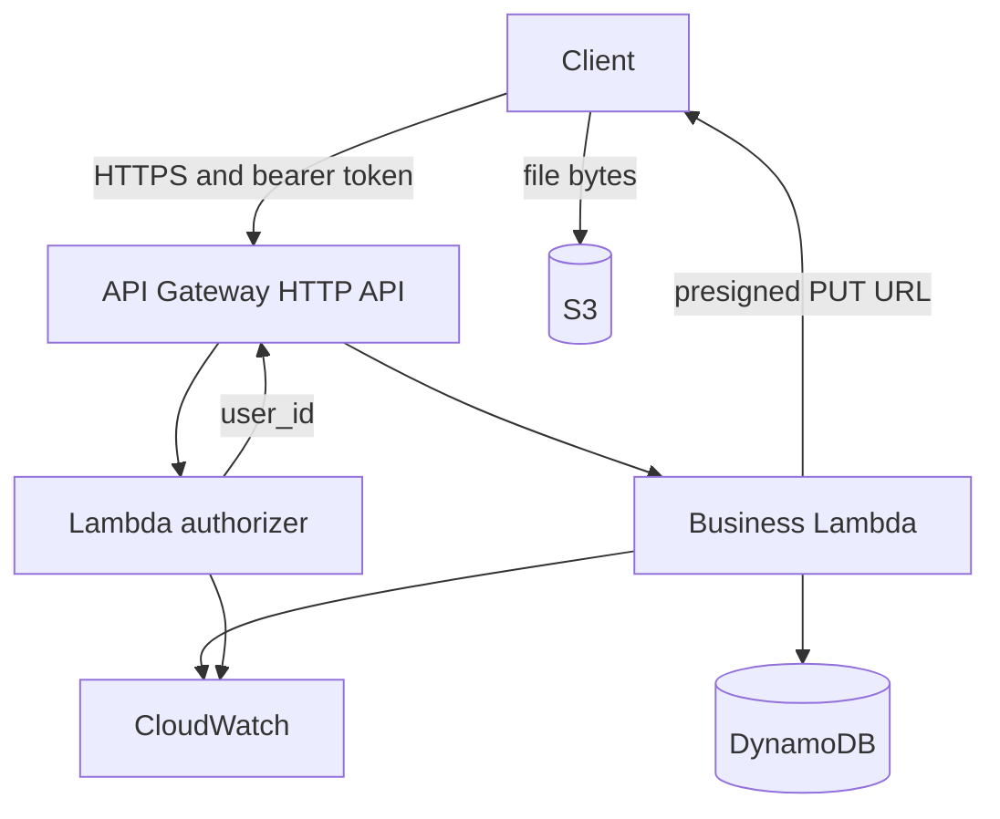

# Expense Tracker API

A small HTTP API for recording spending and reading a month back as a list and a category breakdown. Written in Go.

You register, log an expense, and ask for a month's rows and totals by category. Every expense belongs to the signed-in user, and one user cannot read another user's rows.

The same handlers are meant to run in two places: as an HTTP server in Docker on a laptop, and as a Lambda function behind API Gateway in AWS. **The local half is built and working. The AWS half is designed but not built yet.** See [Status](#status).

## Status

| Step | What | State |
|---|---|---|
| 1 | Go handlers, JWT auth, in-memory stores, unit and handler tests | Done |
| 2 | Docker Compose with DynamoDB Local | Done |
| 3 | DynamoDB store, table creation on startup, integration tests | Done |
| 4 | Lambda entrypoint (`APP_MODE=lambda`) | Next |
| 5 | Lambda authorizer (`cmd/authorizer`) | Planned |
| 6-9 | API Gateway, S3 receipts, IAM roles, CloudWatch | Planned |
| 10-11 | Terraform modules and environments, GitHub Actions with OIDC | Planned |
| 12 | Replace the custom JWT with Amazon Cognito | Planned |
| 13 | Architecture diagram | Planned |

Receipt upload (`POST /receipts/upload`) is a stub that returns `501 Not Implemented` until Step 7.

## Quick start

Requires Go 1.26+ and Docker Desktop.

```bash
docker compose up --build
```

This starts the API on `localhost:8080` and DynamoDB Local on `localhost:8000`. On startup the API creates the `users` and `expenses` tables, retrying for up to 30 seconds while DynamoDB Local boots.

```bash
# create an account
curl -X POST localhost:8080/users/register -H "Content-Type: application/json" \
  -d '{"email":"me@test.com","name":"Me","password":"password123"}'

# log in and keep the token
curl -X POST localhost:8080/users/login -H "Content-Type: application/json" \
  -d '{"email":"me@test.com","password":"password123"}'

# record an expense
curl -X POST localhost:8080/expenses \
  -H "Authorization: Bearer <token>" -H "Content-Type: application/json" \
  -d '{"amount":"42.50","category":"groceries","date":"2026-10-10"}'

# read the month back
curl "localhost:8080/expenses/monthly?month=2026-10" -H "Authorization: Bearer <token>"
curl "localhost:8080/analytics?month=2026-10"        -H "Authorization: Bearer <token>"
```

Data is stored in DynamoDB Local, so it survives `docker compose restart api`. DynamoDB Local runs with `-inMemory`, so it is wiped when that container stops (`docker compose down`).

## API

Register and login are public. Every other route needs `Authorization: Bearer <token>`. Errors are JSON: `{"error": "message"}`.

| Route | Auth | Purpose |
|---|---|---|
| `POST /users/register` | public | Create an account |
| `POST /users/login` | public | Exchange email and password for a token |
| `POST /expenses` | token | Record an expense |
| `GET /expenses/monthly?month=YYYY-MM` | token | Rows for one month, ordered by date |
| `GET /analytics?month=YYYY-MM` | token | Total and per-category sums for one month |
| `POST /receipts/upload` | token | Not implemented yet (`501`) |

### Register and login

```http
POST /users/register
{ "email": "me@test.com", "name": "Me", "password": "password123" }

201 Created
{ "user_id": "user_fd04a043" }
```

```http
POST /users/login
{ "email": "me@test.com", "password": "password123" }

200 OK
{ "token": "eyJhbGciOi..." }
```

- Emails are lowercased, so `A@Test.com` and `a@test.com` are the same account (`409` on a duplicate).
- Passwords must be 8 to 72 characters (bcrypt's limit).
- A wrong password and an unknown email return the same `401`, so the API does not reveal which emails exist.
- Tokens are HS256 JWTs that expire after 24 hours.

### Record an expense

```http
POST /expenses
Authorization: Bearer <token>

{ "amount": "42.5", "category": "Groceries", "date": "2026-10-10" }

201 Created
{ "expense_id": "327c5b6e", "amount": "42.50", "category": "groceries", "date": "2026-10-10" }
```

- `amount` is a positive decimal string, stored with two decimals.
- `category` is trimmed and lowercased.
- `date` is `YYYY-MM-DD`.
- The owner always comes from the token. A `user_id` in the body is ignored.

### Read a month

```http
GET /expenses/monthly?month=2026-10

200 OK
{
  "month": "2026-10",
  "expenses": [
    { "expense_id": "327c5b6e", "amount": "42.50", "category": "groceries", "date": "2026-10-10" }
  ]
}
```

```http
GET /analytics?month=2026-10

200 OK
{
  "month": "2026-10",
  "total": "42.50",
  "by_category": [ { "category": "groceries", "total": "42.50" } ]
}
```

An empty month returns `[]` and `"0.00"`. A missing or malformed `month` returns `400`.

## How it is built

### One handler set, swappable storage

`cmd/api` serves HTTP on `:8080`. Handlers depend on two interfaces, not on a database:

- `auth.UserStore` (`CreateUser`, `GetUserByEmail`)
- `expense.Store` (`Put`, `QueryMonth`)

Each interface has an in-memory implementation (used by the unit and handler tests) and a DynamoDB implementation (`internal/store.DynamoStore`). `main.go` picks one from the environment:

| Environment | Storage |
|---|---|
| `USERS_TABLE` or `EXPENSES_TABLE` unset | In-memory (plain `go run`) |
| Table names and `DYNAMODB_ENDPOINT` set | DynamoDB Local, tables created on startup |
| Table names set, no endpoint | Real DynamoDB. Tables must already exist (Terraform, later). |

### The auth check is one function

`auth.Authorize(token, secret)` verifies the signature and expiry and returns the `user_id`. Locally an HTTP middleware calls it. In AWS the Lambda authorizer (Step 5) will call the same function. Handlers read the user from the request context and never parse a token.

### DynamoDB access patterns

Two tables. Each query the API offers is a key lookup, and nothing scans.

**users.** Partition key `email`, so login is a `GetItem`. Attributes: `user_id`, `name`, `password_hash` (bcrypt), `created_at`. Registration uses a conditional put (`attribute_not_exists(email)`), so two simultaneous sign-ups for one email cannot both succeed.

**expenses.** Partition key `user_id`. Sort key `sk` holding `date#expense_id`, for example `2026-10-10#327c5b6e`.

A monthly report is one `Query`: partition key equals the caller's `user_id`, and `sk` begins with `2026-10`. Results come back already ordered by date, and a paginator handles results larger than one 1 MB page. User isolation falls out of the key, because the store never accepts a `user_id` from the request.

Analytics runs that same query and sums `amount` by `category` in the function. A month of personal expenses is a small result.

## Development

```text
backend/
  cmd/api/              HTTP server, handlers, handler tests
  cmd/authorizer/       placeholder until Step 5
  internal/auth/        passwords, JWT sign and verify, user store
  internal/expense/     expense model, store interface, in-memory store
  internal/analytics/   category totals
  internal/store/       DynamoDB implementation and integration tests
  internal/id/          random ID helper
  *_test.go             auth, expense and analytics unit tests
docker-compose.yml
```

### Tests

```bash
cd backend
go test ./...                                      # no Docker needed
```

```bash
docker compose up -d dynamodb                      # DynamoDB Local on :8000
go test -tags=integration ./internal/store -v
```

Plain `go test ./...` uses the in-memory stores, including the HTTP handler tests, so it needs no Docker. The integration tests carry the `integration` build tag and create uniquely named tables in DynamoDB Local on each run.

| File | What it locks in |
|---|---|
| `auth_test.go` | Password hashing, token signing, wrong secret, missing token, expired token |
| `expense_test.go` | Monthly query and user isolation |
| `analytics_test.go` | Category totals and empty input |
| `cmd/api/handlers_test.go` | Every route through the real router: validation, `401` cases, user isolation, response shapes |
| `internal/store/dynamo_integration_test.go` | Conditional create, month query, ordering, isolation against DynamoDB Local |

### Configuration

| Variable | Local value | Notes |
|---|---|---|
| `JWT_SECRET` | `local-dev-secret` | Required. The API refuses to start without it. |
| `APP_MODE` | `http` | `lambda` arrives in Step 4. |
| `USERS_TABLE` | `users` | |
| `EXPENSES_TABLE` | `expenses` | |
| `DYNAMODB_ENDPOINT` | `http://dynamodb:8000` | Leave unset in AWS. |
| `AWS_REGION` | `us-east-1` | Optional. Local runs default to it. |

## Target AWS design (not built yet)

The local build is the first half of this design. Nothing below exists in an AWS account yet.



1. The client calls API Gateway over HTTPS with a bearer token.
2. The authorizer checks the token and returns the caller's `user_id`. A bad or expired token stops here, and the business function is never invoked.
3. The business function reads `user_id` from the authorizer context and reads or writes DynamoDB.
4. For a receipt, it returns a presigned `PUT` URL and the client uploads straight to S3.
5. CloudWatch keeps logs, latency and an alarm on errors.

Register and login skip step 2.

### Planned pieces

- **Two entrypoints, one codebase.** `cmd/api` runs as HTTP locally and as Lambda with `APP_MODE=lambda`. `cmd/authorizer` is a separate, smaller Lambda that only verifies tokens.
- **Lambda authorizer.** API Gateway's built-in JWT authorizer needs an issuer with a JWKS URL, and a homemade HMAC secret has none. A Lambda authorizer can check that token. The signing secret will live in SSM Parameter Store.
- **Receipts.** A presigned `PUT` that expires in five minutes, with keys `receipts/{user_id}/{expense_id}/{filename}`. The bucket will block public access, use SSE-S3, enable versioning, and expire noncurrent versions after 30 days.
- **Two IAM roles, least privilege.** The business role gets `GetItem`, `PutItem` and `Query` on the two tables, `PutObject` and `GetObject` on `receipts/*`, and its own log group. The authorizer role gets `GetParameter` on the secret and its own log group. The function that stores an expense cannot read the signing secret.
- **CloudWatch.** 14-day log retention, one dashboard (requests, errors, p50, p99) and one error alarm.
- **Terraform.** Modules `api`, `database`, `storage`, `monitoring`, called from `environments/dev`, `staging` and `prod`. Only `dev` will be applied. State keys are separate per environment.
- **GitHub Actions.** Pull requests run the unit and integration tests. Pushes to `main` build the Linux zips and apply `dev`, authenticating with OIDC and no stored access keys.
- **Free-tier discipline.** Both Lambdas run outside a VPC. There is no NAT gateway, RDS, ECS, load balancer or VPC endpoint.

### Phase 2: Cognito

Once phase 1 is deployed, Amazon Cognito replaces the custom login. API Gateway's JWT authorizer validates Cognito tokens (issuer `https://cognito-idp.{region}.amazonaws.com/{userPoolId}`, audience the app client id). The register and login routes, `password_hash`, the authorizer Lambda and the SSM secret are removed. The users table then keys on the Cognito `sub`. The handlers already read `user_id` from request context, so the expense code does not change.
