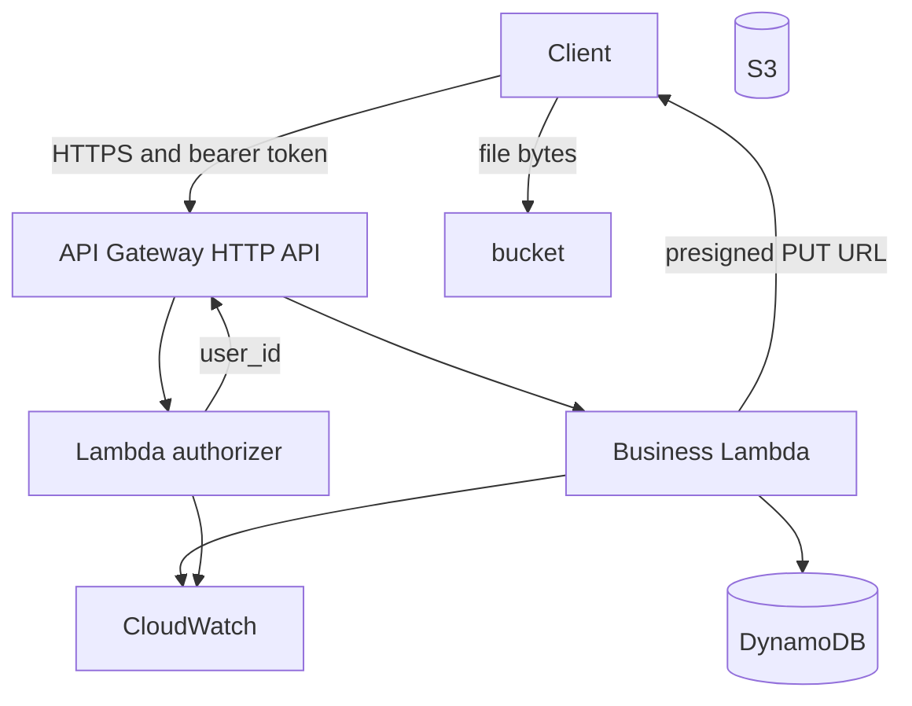

# Expense Tracker API

A small HTTP API for recording spending and reading a month back as a list and a category breakdown. Written in Go.

You register, log an expense, and ask for a month's rows and totals by category. Every expense belongs to the signed-in user, and one user cannot read another user's rows.

The same handlers run two ways: as an HTTP server in Docker locally, and as a Lambda behind API Gateway in AWS. **Local development is complete. Lambda binaries are built. Terraform modules for database, storage, and monitoring are written; the API module and `dev` apply are next.**

## Status

| Step | What | State |
|---|---|---|
| 1 | Go handlers, JWT auth, in-memory stores, unit and handler tests | Done |
| 2 | Docker Compose with DynamoDB Local | Done |
| 3 | DynamoDB store, table creation on startup, integration tests | Done |
| 4 | Business Lambda entrypoint (`APP_MODE=lambda` via `algnhsa`) | Done |
| 5 | Authorizer Lambda (`cmd/authorizer`) | Done |
| 6 | Terraform: `modules/database`, `storage`, `monitoring` | In progress |
| 6–9 | Terraform `modules/api` (API Gateway, Lambdas, IAM), S3 receipts wiring, apply `dev` | Next |
| 10–11 | Environments (`dev`/`staging`/`prod`), GitHub Actions with OIDC | Planned |
| 12 | Replace custom JWT with Amazon Cognito | Planned |
| 13 | Architecture diagram | Planned |

Receipt upload (`POST /receipts/upload`) still returns `501 Not Implemented` until the S3 presigned-URL handler is wired.

### AWS account prep (done)

One-time setup already completed for this project:

| Item | Value |
|---|---|
| Region | `us-east-1` |
| Terraform state bucket | `expense-tracker-tfstate-<account-id>` (versioned, public access blocked) |
| JWT secret | SSM SecureString `/expense-tracker/dev/jwt-secret` |

Local auth uses `aws login` / AWS CLI credentials. Prefer an IAM user over root for day-to-day work.

## Quick start (local)

Requires Go 1.26+ and Docker Desktop.

```bash
docker compose up --build
```

This starts the API on `localhost:8080` and DynamoDB Local on `localhost:8000`. On startup the API creates the `users` and `expenses` tables, retrying for up to 30 seconds while DynamoDB Local boots.

```bash
# create an account
curl -X POST localhost:8080/users/register -H "Content-Type: application/json" \
  -d '{"email":"me@test.com","name":"Me","password":"password123"}'

# log in and keep the token
curl -X POST localhost:8080/users/login -H "Content-Type: application/json" \
  -d '{"email":"me@test.com","password":"password123"}'

# record an expense
curl -X POST localhost:8080/expenses \
  -H "Authorization: Bearer <token>" -H "Content-Type: application/json" \
  -d '{"amount":"42.50","category":"groceries","date":"2026-10-10"}'

# read the month back
curl "localhost:8080/expenses/monthly?month=2026-10" -H "Authorization: Bearer <token>"
curl "localhost:8080/analytics?month=2026-10"        -H "Authorization: Bearer <token>"
```

Data lives in DynamoDB Local, so it survives `docker compose restart api`. DynamoDB Local uses `-inMemory`, so `docker compose down` clears it.

## API

Register and login are public. Every other route needs `Authorization: Bearer <token>`. Errors are JSON: `{"error": "message"}`.

| Route | Auth | Purpose |
|---|---|---|
| `POST /users/register` | public | Create an account |
| `POST /users/login` | public | Exchange email and password for a token |
| `POST /expenses` | token | Record an expense |
| `GET /expenses/monthly?month=YYYY-MM` | token | Rows for one month, ordered by date |
| `GET /analytics?month=YYYY-MM` | token | Total and per-category sums for one month |
| `POST /receipts/upload` | token | Not implemented yet (`501`) |

### Register and login

```http
POST /users/register
{ "email": "me@test.com", "name": "Me", "password": "password123" }

201 Created
{ "user_id": "user_fd04a043" }
```

```http
POST /users/login
{ "email": "me@test.com", "password": "password123" }

200 OK
{ "token": "eyJhbGciOi..." }
```

- Emails are lowercased (`409` on a duplicate).
- Passwords must be 8–72 characters (bcrypt limit).
- Wrong password and unknown email return the same `401`.
- Tokens are HS256 JWTs that expire after 24 hours.

### Record an expense

```http
POST /expenses
Authorization: Bearer <token>

{ "amount": "42.5", "category": "Groceries", "date": "2026-10-10" }

201 Created
{ "expense_id": "327c5b6e", "amount": "42.50", "category": "groceries", "date": "2026-10-10" }
```

- `amount` is a positive decimal string, stored with two decimals.
- `category` is trimmed and lowercased.
- `date` is `YYYY-MM-DD`.
- Owner always comes from the token; a `user_id` in the body is ignored.

### Read a month

```http
GET /expenses/monthly?month=2026-10

200 OK
{
  "month": "2026-10",
  "expenses": [
    { "expense_id": "327c5b6e", "amount": "42.50", "category": "groceries", "date": "2026-10-10" }
  ]
}
```

```http
GET /analytics?month=2026-10

200 OK
{
  "month": "2026-10",
  "total": "42.50",
  "by_category": [ { "category": "groceries", "total": "42.50" } ]
}
```

An empty month returns `[]` and `"0.00"`. A missing or malformed `month` returns `400`.

## How it is built

### One handler set, two runtimes

`cmd/api` serves HTTP on `:8080` when `APP_MODE=http` (or unset). When `APP_MODE=lambda`, it uses `algnhsa` to adapt API Gateway HTTP API (payload v2) events onto the same `http.Handler`.

`cmd/authorizer` is a separate Lambda. It calls the same `auth.Authorize()` used by local HTTP middleware, and returns a simple authorizer response with `user_id` in the context.

### Swappable storage

Handlers depend on interfaces, not a database:

- `auth.UserStore` — `CreateUser`, `GetUserByEmail`
- `expense.Store` — `Put`, `QueryMonth`

| Environment | Storage |
|---|---|
| Table names unset | In-memory (plain `go run` / unit tests) |
| Table names + `DYNAMODB_ENDPOINT` | DynamoDB Local; tables created on startup |
| Table names, no endpoint | Real DynamoDB (Lambda); Terraform owns the tables |

### DynamoDB access patterns

**users.** Partition key `email`. Attributes: `user_id`, `name`, `password_hash`, `created_at`. Registration uses `attribute_not_exists(email)`.

**expenses.** Partition key `user_id`. Sort key `sk` = `date#expense_id` (example: `2026-10-10#327c5b6e`). A month is one `Query` with `begins_with(sk, "YYYY-MM")`. No scans. Analytics sums that query in the function.

## Repository layout

```text
backend/
  cmd/api/                 HTTP + Lambda business entrypoint, handlers, tests
  cmd/authorizer/          Phase 1 JWT authorizer Lambda
  internal/auth/           passwords, JWT, user store
  internal/expense/        expense model + store interface
  internal/analytics/      category totals
  internal/store/          DynamoDB implementation + integration tests
  internal/id/             random IDs
  Dockerfile
docker-compose.yml
infrastructure/terraform/
  modules/
    database/              DynamoDB users + expenses tables
    storage/               S3 receipts bucket (SSE-S3, versioning, lifecycle)
    monitoring/            CloudWatch log groups, dashboard, error alarm
    api/                   (next) HTTP API, Lambdas, IAM, authorizer
  environments/
    dev/                   (next) root module to apply
    staging/               defined later, not applied yet
    prod/
```

## Development

### Tests

```bash
cd backend
go test ./...                                      # no Docker
go test -race ./...
```

```bash
docker compose up -d dynamodb
go test -tags=integration ./internal/store -v
```

| File | What it locks in |
|---|---|
| `auth_test.go` | Password hashing, token signing, wrong/missing/expired token |
| `expense_test.go` | Monthly query and user isolation |
| `analytics_test.go` | Category totals |
| `cmd/api/handlers_test.go` | Every route through the real router |
| `internal/store/dynamo_integration_test.go` | DynamoDB Local create, query, isolation |

### Build Lambda zips (Windows PowerShell)

Lambda `provided.al2023` requires the binary inside the zip to be named `bootstrap`:

```powershell
cd backend
$env:GOOS = "linux"; $env:GOARCH = "amd64"

go build -o $env:TEMP\bootstrap .\cmd\api
Compress-Archive -Force -Path $env:TEMP\bootstrap -DestinationPath $env:TEMP\api.zip

go build -o $env:TEMP\bootstrap .\cmd\authorizer
Compress-Archive -Force -Path $env:TEMP\bootstrap -DestinationPath $env:TEMP\authorizer.zip

Remove-Item Env:GOOS; Remove-Item Env:GOARCH
```

### Local configuration

| Variable | Local value | Notes |
|---|---|---|
| `JWT_SECRET` | `local-dev-secret` | Required |
| `APP_MODE` | `http` | Use `lambda` for the Lambda runtime |
| `USERS_TABLE` | `users` | |
| `EXPENSES_TABLE` | `expenses` | |
| `DYNAMODB_ENDPOINT` | `http://dynamodb:8000` | Leave unset in AWS |
| `AWS_REGION` | `us-east-1` | Optional locally |

## Infrastructure (in progress)

Terraform modules are under `infrastructure/terraform/modules/`. Only **`dev`** will be applied. Staging and prod will call the same modules with a different `environment` name and state key.

### Modules written

| Module | Creates |
|---|---|
| `database` | `users-{env}`, `expenses-{env}` (on-demand) |
| `storage` | Private receipts bucket, SSE-S3, versioning, 30-day noncurrent expiry |
| `monitoring` | 14-day log groups for both Lambdas, one dashboard, one error alarm |

### Still to write

- `modules/api` — two IAM roles (least privilege), business + authorizer Lambdas, API Gateway HTTP API, routes, REQUEST authorizer
- `environments/dev` — backend config pointing at the state bucket, module wiring, outputs (API URL)
- Wire receipt upload to return a presigned PUT
- GitHub Actions + OIDC deploy of `dev`

### Target request path (AWS)



### Planned security split

| Role | Allowed |
|---|---|
| Business Lambda | DynamoDB Get/Put/Query on the two tables; S3 Get/Put on `receipts/*`; own logs |
| Authorizer Lambda | SSM `GetParameter` on the JWT secret; own logs |

The business function cannot read the signing secret. Both Lambdas stay **outside a VPC** (no NAT / interface endpoints) so they use AWS public endpoints for DynamoDB, S3, and SSM.

### Phase 2: Cognito (later)

After phase 1 is deployed, Cognito replaces custom login. API Gateway's JWT authorizer validates Cognito tokens. Register/login routes, `password_hash`, the authorizer Lambda, and the SSM secret go away. Expense handlers already read `user_id` from authorizer context, so they stay put.