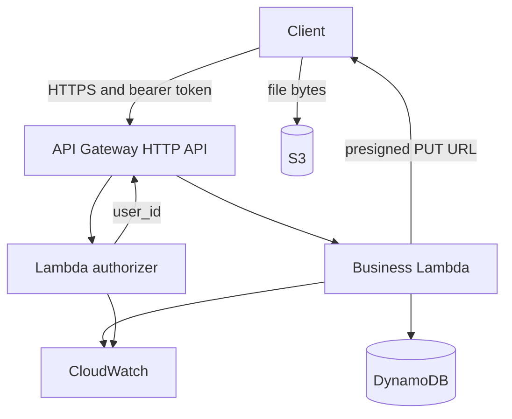

# Expense Tracker API

A Go expense API. Locally it runs in Docker against DynamoDB Local. In AWS it runs as two Lambdas behind an API Gateway HTTP API, with DynamoDB, S3, and CloudWatch provisioned by Terraform.

You register, log an expense, and read a month as rows and category totals. Every expense belongs to the signed-in user.

**Local and AWS phase 1 (including S3 receipt upload) are complete.** Re-apply `dev` to demo, then `terraform destroy` when idle. CI runs tests on every PR; deploy to `dev` uses GitHub Actions OIDC (no long-lived AWS keys in GitHub).

## Status

| Step | What | State |
|---|---|---|
| 1 | Go handlers, JWT auth, in-memory stores, unit and handler tests | Done |
| 2 | Docker Compose + DynamoDB Local | Done |
| 3 | DynamoDB store, startup table creation, integration tests | Done |
| 4 | Business Lambda entrypoint (`APP_MODE=lambda` via `algnhsa`) | Done |
| 5 | Authorizer Lambda (`cmd/authorizer`) | Done |
| 6–9 | Terraform `dev` + S3 receipts (presigned PUT) | Done |
| 10–11 | GitHub Actions CI + OIDC deploy workflows | Done (enable OIDC role once — see below) |
| 12 | Cognito JWT authorizer (phase 2) | Planned |
| 13 | Staging/prod applies + architecture diagram | Planned |

### What stays in AWS after `terraform destroy`

These were created once by hand and are **not** in the Terraform stack. Keep them; they cost effectively nothing:

| Resource | Example |
|---|---|
| Terraform state bucket | `expense-tracker-tfstate-<account-id>` |
| JWT secret (SSM SecureString) | `/expense-tracker/dev/jwt-secret` |

---

## Prerequisites

| Tool | Notes |
|---|---|
| Go 1.26+ | Backend language |
| Docker Desktop | Local API + DynamoDB Local |
| AWS CLI v2 | Prefer an **IAM user with access keys** for Terraform (see below) |
| Terraform ≥ 1.5 | Infrastructure |

---

## Project initialization (local)

### 1. Clone and enter the repo

```powershell
cd D:\DevProjects\PersonalProjects\aws-expense-tracker
```

### 2. Install Go dependencies and run tests

```powershell
cd backend
go mod tidy
go test ./...
go test -race ./...
```

### 3. Run locally with Docker

From the **repo root** (not `backend/`):

```powershell
cd D:\DevProjects\PersonalProjects\aws-expense-tracker
docker compose up --build
```

| Service | Port |
|---|---|
| API (`APP_MODE=http`) | `8080` |
| DynamoDB Local | `8000` |

On startup the API creates the `users` and `expenses` tables when `DYNAMODB_ENDPOINT` is set.

Optional LocalStack for local receipt uploads (see **Local receipt uploads** below):

```powershell
docker compose --profile aws -f docker-compose.yml -f docker-compose.receipts.yml up --build
```

### 4. Smoke-test the local API (PowerShell)

Use **single-quoted** JSON bodies so PowerShell does not mangle escapes:

```powershell
curl.exe -X POST http://localhost:8080/users/register `
  -H "Content-Type: application/json" `
  -d '{"email":"me@test.com","name":"Me","password":"password123"}'

curl.exe -X POST http://localhost:8080/users/login `
  -H "Content-Type: application/json" `
  -d '{"email":"me@test.com","password":"password123"}'
```

Or with `Invoke-RestMethod`:

```powershell
$login = Invoke-RestMethod -Method POST -Uri http://localhost:8080/users/login `
  -ContentType "application/json" `
  -Body '{"email":"me@test.com","password":"password123"}'
$TOKEN = $login.token

Invoke-RestMethod -Method POST -Uri http://localhost:8080/expenses `
  -Headers @{ Authorization = "Bearer $TOKEN" } `
  -ContentType "application/json" `
  -Body '{"amount":"42.50","category":"groceries","date":"2026-10-10"}'

Invoke-RestMethod -Method GET -Uri "http://localhost:8080/expenses/monthly?month=2026-10" `
  -Headers @{ Authorization = "Bearer $TOKEN" }

Invoke-RestMethod -Method GET -Uri "http://localhost:8080/analytics?month=2026-10" `
  -Headers @{ Authorization = "Bearer $TOKEN" } | ConvertTo-Json -Depth 5
```

Data survives `docker compose restart api`. `docker compose down` wipes DynamoDB Local (`-inMemory`).

### Integration tests

```powershell
docker compose up -d dynamodb
cd backend
go test -tags=integration ./internal/store -v
```

---

## API reference

Register and login are public. Every other route needs `Authorization: Bearer <token>`. Errors: `{"error":"message"}`.

| Route | Auth | Purpose |
|---|---|---|
| `POST /users/register` | public | Create an account |
| `POST /users/login` | public | Get a JWT |
| `POST /expenses` | token | Record an expense |
| `GET /expenses/monthly?month=YYYY-MM` | token | Month rows, ordered by date |
| `GET /analytics?month=YYYY-MM` | token | Total + per-category sums |
| `POST /receipts/upload` | token | Presigned S3 PUT URL (`501` if `RECEIPTS_BUCKET` unset) |

### Behaviour notes

- Emails are lowercased; duplicate → `409`.
- Passwords must be 8–72 characters.
- Wrong password and unknown email return the same `401`.
- Tokens are HS256 JWTs, 24-hour expiry.
- `amount` is a positive decimal string (stored with two decimals).
- `category` is trimmed and lowercased; `date` is `YYYY-MM-DD`.
- Owner always comes from the token; body `user_id` is ignored.
- Empty month → `[]` and `"0.00"`.

---

## How it is built

### Two entrypoints, one handler set

- `cmd/api` — HTTP on `:8080` when `APP_MODE=http`; Lambda when `APP_MODE=lambda` (`algnhsa` adapts API Gateway HTTP API v2).
- `cmd/authorizer` — verifies the JWT with the same `auth.Authorize()` used by local middleware; returns `user_id` in the authorizer context.

### Swappable storage

| Env | Storage |
|---|---|
| Table names unset | In-memory (tests / plain `go run`) |
| Tables + `DYNAMODB_ENDPOINT` | DynamoDB Local; tables created on startup |
| Tables, no endpoint | Real DynamoDB (Lambda); Terraform owns tables |

**users:** PK `email`.  
**expenses:** PK `user_id`, SK `sk` = `date#expense_id`. Monthly report = one `Query` with `begins_with(sk, "YYYY-MM")`. No scans.

### Repository layout

```text
backend/
  cmd/api/                 HTTP + Lambda business entrypoint
  cmd/authorizer/          Phase 1 JWT authorizer
  internal/auth|expense|analytics|store|id/
  Dockerfile
docker-compose.yml
infrastructure/terraform/
  modules/
    database/              DynamoDB tables
    storage/               S3 receipts bucket
    monitoring/            Log groups, dashboard, alarm
    api/                   IAM, Lambdas, HTTP API, authorizer, routes
  environments/
    dev/                   Root module (apply this)
    staging/               Placeholder
    prod/                  Placeholder
```

### Local env vars (Compose sets these)

| Variable | Local value |
|---|---|
| `JWT_SECRET` | `local-dev-secret` |
| `APP_MODE` | `http` |
| `USERS_TABLE` | `users` |
| `EXPENSES_TABLE` | `expenses` |
| `DYNAMODB_ENDPOINT` | `http://dynamodb:8000` |
| `RECEIPTS_BUCKET` | unset by default → receipts return `501` |

### Local receipt uploads (optional LocalStack)

```powershell
docker compose --profile aws -f docker-compose.yml -f docker-compose.receipts.yml up --build

$env:AWS_ACCESS_KEY_ID = "test"
$env:AWS_SECRET_ACCESS_KEY = "test"
aws --endpoint-url=http://localhost:4566 s3 mb s3://expense-tracker-receipts-local
```

Then call `POST /receipts/upload` with `expense_id`, `filename`, `content_type`, and `date`, and `PUT` the file to `upload_url` within **5 minutes**.

---

## AWS credentials (important)

### Why `aws login` fights you

| Tool | What it uses |
|---|---|
| AWS CLI after `aws login` | Browser login session on the profile |
| Terraform AWS provider | SDK chain: env vars → `~/.aws/credentials` → … |

Problems you will hit with `aws login` alone:

1. Terraform often **cannot** see the login session → `No valid credential sources found`.
2. If you `export-credentials` into `$env:AWS_*` and those expire, later `aws sts` fails with `ExpiredToken` even after a fresh `aws login`, because **env vars override** the profile.
3. Session tokens expire (often within hours).

**Recommendation:** create an IAM user with long-lived access keys for day-to-day CLI + Terraform. Use `aws login` only for one-off console-style access if you want.

### Recommended: IAM user with access keys (long-term)

Do this once while logged in as root (or an admin). Prefer **not** using root for daily work afterward.

#### 1. Create the user (Console)

1. AWS Console → **IAM** → **Users** → **Create user**
2. Name: e.g. `expense-tracker-dev`
3. **Attach policies directly** for learning (tighten later):
   - `AdministratorAccess` is simplest for a personal sandbox, **or**
   - a narrower set: IAM, Lambda, API Gateway, DynamoDB, S3, SSM, CloudWatch, CloudWatch Logs
4. Create user → open the user → **Security credentials** → **Create access key**
5. Use case: **Command Line Interface (CLI)**
6. Copy **Access key ID** and **Secret access key** once (secret is shown only once)

#### 2. Or create via CLI (if you already have working admin creds)

```powershell
aws iam create-user --user-name expense-tracker-dev

aws iam attach-user-policy `
  --user-name expense-tracker-dev `
  --policy-arn arn:aws:iam::aws:policy/AdministratorAccess

aws iam create-access-key --user-name expense-tracker-dev
```

Save the printed `AccessKeyId` and `SecretAccessKey`.

#### 3. Configure the CLI profile (no more `aws login` for Terraform)

```powershell
# Clear any leftover temporary session env vars first
Remove-Item Env:AWS_ACCESS_KEY_ID -ErrorAction SilentlyContinue
Remove-Item Env:AWS_SECRET_ACCESS_KEY -ErrorAction SilentlyContinue
Remove-Item Env:AWS_SESSION_TOKEN -ErrorAction SilentlyContinue

aws configure
# AWS Access Key ID:     <from IAM>
# AWS Secret Access Key: <from IAM>
# Default region:        us-east-1
# Default output:        json
```

Verify:

```powershell
aws sts get-caller-identity
```

You should see an ARN like:

```text
arn:aws:iam::611728563978:user/expense-tracker-dev
```

not `:root`.

Terraform and the CLI now share `~/.aws/credentials`. No export step, no browser login expiry for normal `plan` / `apply` / `destroy`.

#### 4. Security hygiene

- Never commit access keys, `terraform.tfvars`, or files like `setcredentials.txt`.
- Do not paste secrets into the repo or chat logs.
- Rotate keys if they leak: IAM → user → create new key → delete old key.
- For CI later, prefer **GitHub OIDC** (no long-lived keys in GitHub secrets).

### If you still use `aws login` temporarily

```powershell
aws login

# Drop expired env overrides
Remove-Item Env:AWS_ACCESS_KEY_ID, Env:AWS_SECRET_ACCESS_KEY, Env:AWS_SESSION_TOKEN -ErrorAction SilentlyContinue

aws sts get-caller-identity

# Only if Terraform still cannot find creds — export into THIS shell only
aws configure export-credentials --format env
# Convert to PowerShell:
# $env:AWS_ACCESS_KEY_ID = "..."
# $env:AWS_SECRET_ACCESS_KEY = "..."
# $env:AWS_SESSION_TOKEN = "..."
$env:AWS_REGION = "us-east-1"
```

Never save exported session tokens into a tracked file.

---

## Deploy to AWS (`dev`) — full runbook

Region: **`us-east-1`**. Always run Terraform from:

```text
infrastructure/terraform/environments/dev
```

not the repo root.

### One-time account prep (already done for this project)

```powershell
aws sts get-caller-identity

$ACCOUNT = "<your-12-digit-account-id>"
$BUCKET = "expense-tracker-tfstate-$ACCOUNT"

aws s3api create-bucket --bucket $BUCKET --region us-east-1
aws s3api put-bucket-versioning --bucket $BUCKET --versioning-configuration Status=Enabled
aws s3api put-public-access-block --bucket $BUCKET `
  --public-access-block-configuration `
  BlockPublicAcls=true,IgnorePublicAcls=true,BlockPublicPolicy=true,RestrictPublicBuckets=true

$SECRET = -join ((48..57)+(65..90)+(97..122) | Get-Random -Count 48 | ForEach-Object {[char]$_})
aws ssm put-parameter `
  --name "/expense-tracker/dev/jwt-secret" `
  --value $SECRET `
  --type SecureString `
  --overwrite `
  --region us-east-1
Remove-Variable SECRET
```

Match `backend.tf` to your state bucket name (example):

```hcl
bucket = "expense-tracker-tfstate-611728563978"
key    = "expense-tracker/dev/terraform.tfstate"
region = "us-east-1"
```

### Build Lambda zips (before every apply that changes Go code)

Runtime `provided.al2023` requires the binary inside the zip to be named `bootstrap`:

```powershell
cd D:\DevProjects\PersonalProjects\aws-expense-tracker\backend
$env:GOOS = "linux"; $env:GOARCH = "amd64"

go build -o $env:TEMP\bootstrap .\cmd\api
Compress-Archive -Force -Path $env:TEMP\bootstrap -DestinationPath $env:TEMP\api.zip

go build -o $env:TEMP\bootstrap .\cmd\authorizer
Compress-Archive -Force -Path $env:TEMP\bootstrap -DestinationPath $env:TEMP\authorizer.zip

Remove-Item Env:GOOS; Remove-Item Env:GOARCH
Test-Path $env:TEMP\api.zip, $env:TEMP\authorizer.zip
```

Create gitignored `infrastructure/terraform/environments/dev/terraform.tfvars`:

```hcl
api_zip_path        = "C:/Users/<you>/AppData/Local/Temp/api.zip"
authorizer_zip_path = "C:/Users/<you>/AppData/Local/Temp/authorizer.zip"
```

### Apply

```powershell
# Creds: IAM user via `aws configure` (preferred), or aws login + export as above
aws sts get-caller-identity

cd D:\DevProjects\PersonalProjects\aws-expense-tracker\infrastructure\terraform\environments\dev
terraform init
terraform plan
terraform apply
terraform output api_endpoint
```

### Smoke-test the live API

```powershell
$API = terraform output -raw api_endpoint

Invoke-RestMethod -Method POST -Uri "$API/users/register" `
  -ContentType "application/json" `
  -Body '{"email":"me@test.com","name":"Me","password":"password123"}'

$login = Invoke-RestMethod -Method POST -Uri "$API/users/login" `
  -ContentType "application/json" `
  -Body '{"email":"me@test.com","password":"password123"}'
$TOKEN = $login.token

Invoke-RestMethod -Method POST -Uri "$API/expenses" `
  -Headers @{ Authorization = "Bearer $TOKEN" } `
  -ContentType "application/json" `
  -Body '{"amount":"42.50","category":"groceries","date":"2026-10-10"}'

Invoke-RestMethod -Method GET -Uri "$API/expenses/monthly?month=2026-10" `
  -Headers @{ Authorization = "Bearer $TOKEN" }

Invoke-RestMethod -Method GET -Uri "$API/analytics?month=2026-10" `
  -Headers @{ Authorization = "Bearer $TOKEN" } | ConvertTo-Json -Depth 5
```

Verified previously against a live `dev` stack: register, login, create expense, monthly, analytics, and receipt upload all succeeded.

### Smoke-test receipt upload (after apply)

Rebuild Lambda zips before apply whenever Go changes — otherwise AWS keeps the old binary.

```powershell
$API = terraform output -raw api_endpoint
# ... register, login → $TOKEN, create expense → $exp ...

$upload = Invoke-RestMethod -Method POST -Uri "$API/receipts/upload" `
  -Headers @{ Authorization = "Bearer $TOKEN" } `
  -ContentType "application/json" `
  -Body (@{
    expense_id   = $exp.expense_id
    filename     = "receipt.jpg"
    content_type = "image/jpeg"
    date         = "2026-10-10"
  } | ConvertTo-Json)

# Upload immediately (URL expires in 300 seconds)
Set-Content -Path "$env:TEMP\receipt.jpg" -Value "fake-image-bytes" -NoNewline
Invoke-WebRequest -Method PUT -Uri $upload.upload_url `
  -ContentType "image/jpeg" `
  -InFile "$env:TEMP\receipt.jpg"

aws s3 ls ("s3://{0}/receipts/" -f (terraform output -raw receipts_bucket_name)) --recursive
```

### Destroy (stay near free tier when not demoing)

```powershell
aws sts get-caller-identity   # fix creds first if this fails

cd D:\DevProjects\PersonalProjects\aws-expense-tracker\infrastructure\terraform\environments\dev
terraform destroy
# type yes

# Confirm
terraform show
aws lambda list-functions --query "Functions[?contains(FunctionName, 'expense-tracker')].FunctionName"
aws apigatewayv2 get-apis --query "Items[?contains(Name, 'expense-tracker')].Name"
```

Expect: `The state file is empty`, and `[]` / `[]` for Lambda and API Gateway queries.

#### If destroy fails with `BucketNotEmpty`

The receipts bucket has **versioning** on. Uploaded files (and delete markers) block `DeleteBucket`. `aws s3 rm --recursive` is **not** enough — delete every object **version** first, then re-run destroy:

```powershell
$bucket = "expense-tracker-receipts-dev-611728563978"
# Or: $bucket = terraform output -raw receipts_bucket_name   # if destroy hasn't removed the output yet

$json = aws s3api list-object-versions --bucket $bucket --output json | ConvertFrom-Json
$objects = @()
if ($json.Versions) {
  $objects += $json.Versions | ForEach-Object { @{ Key = $_.Key; VersionId = $_.VersionId } }
}
if ($json.DeleteMarkers) {
  $objects += $json.DeleteMarkers | ForEach-Object { @{ Key = $_.Key; VersionId = $_.VersionId } }
}

if ($objects.Count -gt 0) {
  $tmp = "$env:TEMP\s3-delete.json"
  @{ Objects = @($objects); Quiet = $true } | ConvertTo-Json -Depth 5 |
    Set-Content -Path $tmp -Encoding utf8
  aws s3api delete-objects --bucket $bucket --delete "file://$tmp"
}

cd D:\DevProjects\PersonalProjects\aws-expense-tracker\infrastructure\terraform\environments\dev
terraform destroy
```

Re-demo later: rebuild zips → `terraform apply` → smoke-test → empty bucket if needed → `terraform destroy` when finished.

### Free-tier habits

- Apply only `environments/dev`.
- Destroy when idle (Lambdas, API Gateway, DynamoDB on-demand, S3 app bucket all go away).
- Keep Lambdas **outside a VPC** (no NAT Gateway).
- Do not add RDS, ALB, ECS, or VPC interface endpoints for this project.
- State bucket + one SSM parameter can remain.

---

## Infrastructure design

| Module | Creates |
|---|---|
| `database` | `users-{env}`, `expenses-{env}` (on-demand) |
| `storage` | Private receipts bucket, SSE-S3, versioning, 30-day noncurrent expiry |
| `monitoring` | 14-day log groups, one dashboard, one error alarm |
| `api` | Two IAM roles, two Lambdas, HTTP API, REQUEST authorizer, routes; `RECEIPTS_BUCKET` on the business Lambda |
| `github-oidc` | GitHub Actions OIDC provider + deploy role (apply once via `environments/oidc`) |



| Role | Allowed |
|---|---|
| Business Lambda | DynamoDB Get/Put/Query; S3 Get/Put on `receipts/*`; own logs. JWT secret injected at deploy (no `ssm:GetParameter` on the role). |
| Authorizer Lambda | `ssm:GetParameter` on the JWT secret; own logs |

Both Lambdas stay outside a VPC.

### Phase 2 (later)

Cognito replaces custom login. API Gateway JWT authorizer validates Cognito tokens. Register/login routes, `password_hash`, the authorizer Lambda, and the SSM secret go away. Expense handlers already key off `user_id` from authorizer context.

---

## CI/CD (GitHub Actions + OIDC)

Workflows live under `.github/workflows/`:

| Workflow | When | What |
|---|---|---|
| `ci.yml` | PR + push to `main` | `go test ./...` and integration tests against DynamoDB Local |
| `deploy.yml` | Push to `main` (and manual `workflow_dispatch`) | Build Linux Lambda zips → `terraform apply` in `environments/dev` via OIDC |

No AWS access keys are stored in GitHub. Actions assume an IAM role with a short-lived token.

### One-time: create the OIDC role

With local AWS credentials that can manage IAM:

```powershell
cd D:\DevProjects\PersonalProjects\aws-expense-tracker\infrastructure\terraform\environments\oidc
terraform init
terraform apply
terraform output -raw aws_role_arn
```

Copy the role ARN.

If apply fails because the GitHub OIDC provider already exists in the account, import it then re-apply:

```powershell
aws iam list-open-id-connect-providers
terraform import module.github_oidc.aws_iam_openid_connect_provider.github `
  arn:aws:iam::611728563978:oidc-provider/token.actions.githubusercontent.com
terraform apply
```

### One-time: GitHub repository secret

In the GitHub repo → **Settings** → **Secrets and variables** → **Actions**:

| Name | Value |
|---|---|
| `AWS_ROLE_ARN` | output of `terraform output -raw aws_role_arn` |

The trust policy allows only `repo:gazimaksudur2/aws-expense-tracker:*`.

### What happens on push to `main`

1. CI runs unit + integration tests.
2. Deploy builds `bootstrap` zips for `cmd/api` and `cmd/authorizer`.
3. `aws-actions/configure-aws-credentials` assumes `AWS_ROLE_ARN` via OIDC.
4. `terraform apply` updates `dev` (uses the S3 state bucket and SSM JWT secret you already created).

**Cost:** a push to `main` leaves the stack running. Destroy when idle:

```powershell
cd infrastructure\terraform\environments\dev
terraform destroy
```

Or add a manual destroy workflow later.

### Local develop vs CI

| Task | Local | CI |
|---|---|---|
| Unit tests | `go test ./...` | `ci.yml` |
| Integration tests | DynamoDB Local via Compose | service container on `:8000` |
| Deploy | rebuild zips + `terraform apply` | `deploy.yml` on `main` |

---

## Troubleshooting

| Symptom | Fix |
|---|---|
| `terraform plan` → no credentials / IMDS timeout | Configure IAM access keys, or clear expired `$env:AWS_*` and export a fresh session |
| `aws sts` → `ExpiredToken` after `aws login` | `Remove-Item Env:AWS_ACCESS_KEY_ID, Env:AWS_SECRET_ACCESS_KEY, Env:AWS_SESSION_TOKEN` then retry |
| `terraform plan` → no configuration files | `cd` into `environments/dev` |
| `curl` → invalid JSON / bad hostname on PowerShell | Use single-quoted JSON or `Invoke-RestMethod` |
| IAM `MalformedPolicyDocument` | Policy JSON keys must be `Version`, `Statement`, `Effect`, `Action`, `Resource` (capital R) |
| Lambda zip issues | Binary inside zip must be named `bootstrap`; rebuild with `GOOS=linux GOARCH=amd64` |
| Live API still says `receipt upload arrives in step 7` | Old zip deployed — rebuild zips and `terraform apply` again |
| S3 `Request has expired` on PUT | Presigned URL is 5 minutes — request a new URL and upload immediately |
| `terraform destroy` → S3 `BucketNotEmpty` | Receipts bucket is versioned — delete all versions/delete markers (see Destroy section), then destroy again |
| Deploy workflow `Not authorized to perform sts:AssumeRoleWithWebIdentity` | Apply `environments/oidc`, set `AWS_ROLE_ARN` secret, ensure repo name matches the trust policy |

---

## Still to do

1. Set GitHub Actions secret `AWS_ROLE_ARN` to `arn:aws:iam::611728563978:role/expense-tracker-github-actions` (OIDC role already applied)
2. Optionally read `user_id` only from API Gateway authorizer context in Lambda mode
3. Cognito (phase 2)
4. Staging/prod root modules (apply only when needed)
