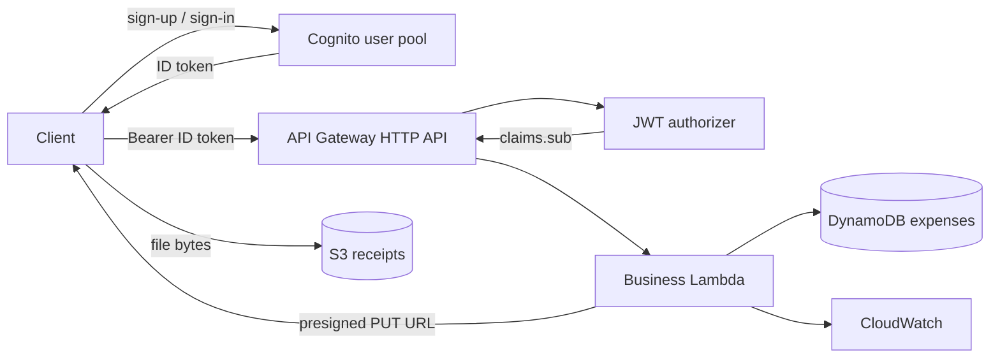
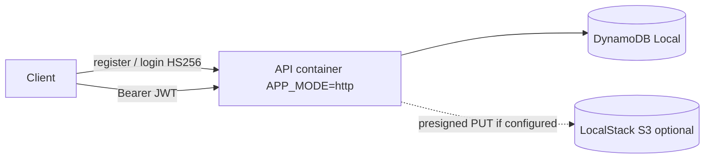

# Architecture

Living diagram for the AWS expense tracker (phase 2: Cognito). Same topology as the Mermaid block in the root README.

## Runtime (AWS)

## Local Docker

## Terraform layout

| Path | Role |
|---|---|
| `modules/database` | DynamoDB users + expenses |
| `modules/storage` | Receipts bucket |
| `modules/cognito` | User pool + app client |
| `modules/api` | Lambda + HTTP API + JWT authorizer |
| `modules/monitoring` | Logs, dashboard, alarm |
| `modules/github-oidc` | GitHub Actions deploy role |
| `environments/dev` | Day-to-day demo stack |
| `environments/staging` | Optional second stack |
| `environments/prod` | Optional long-lived stack — apply only when needed |
| `environments/oidc` | One-time OIDC provider + role |

## Auth split

| Surface | Identity |
|---|---|
| Local Docker | `POST /users/register` + `/login`, HS256 `JWT_SECRET` |
| AWS | Cognito; API Gateway JWT authorizer; Lambda reads `sub` |

See also: [architecture.svg](./architecture.svg) (static overview).
